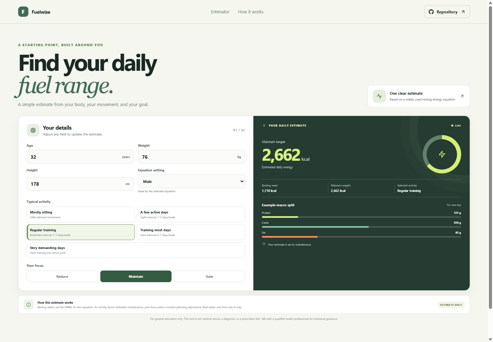

# Fuelwise: Calorie Intake Estimator

Fuelwise estimates a daily energy range from age, height, weight, activity, and a chosen goal. Use it as a starting point for learning about personal energy needs, not as a medical or nutrition prescription.

**Project repository:** https://github.com/a2rp/calorie-intake-estimator
**Deployed site:** https://a2rp.github.io/calorie-intake-estimator/

## What is included

- Enter age, height, weight, and a sex value used by the selected equation.
- Choose an activity level and a goal to see a refreshed daily estimate.
- Compare estimated resting needs, maintenance calories, and the goal-adjusted target.
- Review an illustrative protein, carbohydrate, and fat split.
- Read a plain-language explanation of the estimator and its limits.

## How to use it

Change the measurements and selections in the form. The result updates as you make changes. Switch between maintain, reduce, and gain to compare target estimates. The macro amounts are planning examples derived from the entered weight and estimated energy target.

## Calculation and data

Fuelwise uses the Mifflin-St Jeor resting-energy equation and multiplies it by a standard activity factor to estimate maintenance energy. The goal selection applies a fixed planning adjustment to that estimate. It does not collect or save personal measurements. The calculation is an approximation and does not account for medical conditions, pregnancy, age under 18, or individual nutrition needs.

## Run and check locally

Install dependencies with `npm install`, then start Vite with `npm run dev`. Run `npm run lint` for ESLint and `npm run build` for the production build. Run `npm run deploy` to build and publish `dist` to the `gh-pages` branch.

## Future improvements

Ideas only. These are not implemented yet:

- Add metric and imperial unit switching.
- Offer goal adjustments as a range that can be tuned.
- Add an optional saved profile that remains only on the device.

## Links

- Portfolio: [https://www.ashishranjan.net](https://www.ashishranjan.net)
- GitHub: [https://github.com/a2rp](https://github.com/a2rp)
- CodePen: [https://codepen.io/ash1198](https://codepen.io/ash1198)
- LinkedIn: [https://www.linkedin.com/in/aashishranjan](https://www.linkedin.com/in/aashishranjan)
- Facebook: [https://www.facebook.com/theash.ashish/](https://www.facebook.com/theash.ashish/)
- YouTube: [https://www.youtube.com/@ashishranjan-ashz?sub_confirmation=1](https://www.youtube.com/@ashishranjan-ashz?sub_confirmation=1)
- Email: [mailto:ash.ranjan09@gmail.com](mailto:ash.ranjan09@gmail.com)

## Support

- Support: [https://a2rp-donation-page.netlify.app/](https://a2rp-donation-page.netlify.app/)
- Buy Me a Coffee: [https://buymeacoffee.com/ashishranjan](https://buymeacoffee.com/ashishranjan)
- Patreon: [https://www.patreon.com/ashishranjan](https://www.patreon.com/ashishranjan)